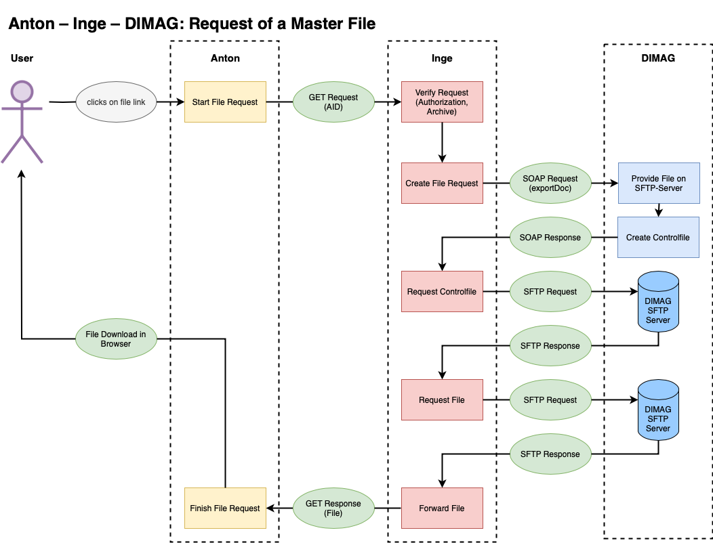

# Inge und Dimag

Mit Inge ist es möglich, DIMAG als Repository für die Primärdaten zu integrieren. Die originalen Dateien werden dann nicht im lokalen Filesystem von Anton, sondern in DIMAG gespeichert. Nur die Dateien, die für das Internet optimiert wurden, bleiben in Anton. Wenn nötig können interne User die originalen Dateien herunterladen. Aus Perspektive der Nutzer:innen gibt es deshalb keinen Unterschied.

## Voraussetzungen 
- Setting `fulltext-from-webpdf`: true 
- Setting `cloud`: "inge"
- .env INGE_API_TOKEN 
- Benutzer «Inge» mit E-Mail-Adresse und `api_token` für Inge, mit
  mindestens der Rolle **editor**

!!! warning "Inge braucht die Rolle editor"
    Den Ingest bestätigen und den Stand davor wiederherstellen
    (`/api/sips/{id}/confirm` und `/revert`) dürfen nur Bearbeiter:innen —
    ein Token allein genügt nicht. Hat der Dienstbenutzer «Inge» die Rolle
    nicht, quittiert Anton den Abschluss des Umlaufs mit einem 403, und der
    Ingest bleibt unbestätigt stehen.

### Ablauf des SIP-Ingest

#### Anton
- User: SIP Upload (zip) (`/sip/uploadsip`)
- User: SIP Validation (`/sip/validation`)
    - Anton kann das SIP auspacken (unzip) und die Metadaten-Datei ist lesbar.
    - Die Dateien aus dem SIP sind vorhanden und die Prüfsummen sind korrekt.
    - Anton kann für jedes Dossier im SIP einen parent in Anton finden.
- User: Anton-Ingest (`/sip/ingest`)
    - Backup der Datenbank
    - Import SIP (`<dossier>` and `<dokument>`/`<datei>`)
        - Eintrag im Importprotokoll, Signatur `IMPORT-{jjjj}-{NNN}`
        - Import Dossiers and Dokumente/Dateien 
            - Anton erstellt Web-Versionen und Thumbs
            - falls der SIP-Ingest mit Inge und DIMAG erfolgt löscht Anton die  Masterdateien
        - Signaturen und Dateinamen basieren zunächst auf UUIDs
    - Post Import (Listener `ImportFinished``)
        - Update der Archiv-Hierarchie (`path`)
        - Update der Datierungen und des Volltextindexes

Mit dem event `MediumAdded` wird der Import der einzelnen Medien ausgelöst, der jeweils asynchron erledigt wird.

#### Ingest mit Inge in DIMAG

Das event `MediumAdded` wird verzögert ausgelöst, d.h. nachdem der Import abgeschlossen ist und die Signaturen bereits korrigiert wurden. Dieses event löst die Konvertierung der Medien aus (Listener `MediumCreateWebVersion`). Bei Verwendung von Inge wird die Original Datei in den sips Pfad kopiert, wo auch Inge zugreifen kann. Dann erfolgt der Import in Inge (`Anton\Helpers\Inge::class`, `import`). Wenn Inge einen Erfolg zurückmeldet, werden die Konvertierungen durchgeführt und das Master Medium wir gelöscht.

Inge: 
- Anton schickt einen Request pro Datei an Inge mit dem SIP and einer Liste der Anton-Medien-Ids
- Inge: Ingest der Dateien in DIMAG
    - Inge erstellt eine loadXML-Datei
    - Inge erstellt ein Ingest-Paket und sichert es auf DIMAGs SFTP-Storage
    - Inge sendet einen Request an DIMAG: Ingest des SIP
- DIMAG: Importiert das Paket and sendet das Resultat an Inge 
- Inge: Inge sendet das Resultat an Anton
- Anton: Finalisiere den SIP-Ingest
    - Bestätige den Ingest (DIMAG-Bericht am Lauf) oder stelle den Zustand vor dem Ingest aus der Sicherung wieder her 
    - Schicke eine Email an User Inge mit dem Resultat 

### Abfrage eines Master Files




## CLI 
```bash 
php artisan anton:import --env {slug} --from-sip --no-validation 
--create-actors -vv {path/to/sip} --import
```

### Einen SIP-Import zurücknehmen oder mit Inge bestätigen

Vor einem SIP-Import sichert Anton die Datenbank; geht etwas schief, lässt sich damit der Zustand vor dem Import wiederherstellen.

Der Name der Sicherung steht am Lauf, im Importprotokoll unter *Admin → Daten-Import → Imports*.

Der folgende Befehl stellt die Datenbank aus der letzten Sicherung wieder her und gleicht die Medien mit der Datenbank ab (löscht also Medien, die in der Datenbank nicht registriert sind):

```bash
php artisan sip:check-import --env {slug} --id {run_id} -vv --revert
```

Die `run_id` ist die Lauf-Id aus dem Importprotokoll (`/import/audit/{run_id}`). `--list` zeigt die letzten Läufe, `--check` prüft nur den Zustand.

!!! warning "Nur die neueste Sicherung"
    Wiederhergestellt wird nur die Sicherung dieses Laufs, und nur solange sie die neueste ist. Eine ältere verwirft alles Spätere — auch die Arbeit anderer.

Der folgende Befehl bestätigt den Lauf und vermerkt den DIMAG-Bericht daran:

```bash
php artisan sip:check-import --env {slug} --id {run_id} -vv --confirm
```


### Medienabgleich prüfen und reparieren (Anton ↔ Inge ↔ Dimag)

`media:check` prüft die Konsistenz zwischen Anton-Datenbank, lokalem Filesystem, Inge und Dimag.

```bash
# Gesamtüberblick (Counts + Verifikation + Orphan-Check)
php artisan media:check --levels=1,5,6 --env={slug} -vv

# Nur einen bestimmten SIP prüfen (nach unterbrochenem Ingest);
# {run_id} ist die Lauf-Id aus dem Importprotokoll
php artisan media:check --levels=1,5,6 --sip={run_id} --env={slug} -vv

# cloud_status in der DB reparieren (wenn Inge status=20, aber DB falsch)
php artisan media:check --levels=5 --fix-cloud-status --env={slug} -vv

# Waisen aus Inge/Dimag löschen die nicht mehr in Anton sind
php artisan media:check --levels=6 --delete-from-inge --env={slug} -vv
```

**Levels:**

| Level | Prüft | 
|-------|-------|
| 1 | Count-Vergleich: DB, Filesystem, Inge, Dimag. Bei Abweichung zeigt eine Diff-Tabelle die konkreten Media-IDs pro System. |
| 2 | DB → Filesystem (übersprungen bei cloud=inge) |
| 3 | Filesystem → DB. Mit `--delete-from-system` werden verwaiste Verzeichnisse gelöscht. |
| 4 | Integritätsprüfung (Checksummen, übersprungen bei cloud=inge) |
| 5 | DB → Inge: Prüft ob alle Medien in Inge mit status=20 vorhanden sind, ebenso die [Originale in DIMAG](#originale-in-dimag). `--fix-cloud-status` repariert die DB, `--delete-local-masters` löscht lokale Masterdateien nach Verifikation. |
| 6 | Inge/Dimag → DB: Findet Waisen in Inge oder Dimag die nicht in Anton sind. `--delete-from-inge` löscht verwaiste Medien-AIDs (`<slug>-media-<id>`). AIDs von Originalen ohne Eintrag in Anton werden nur gemeldet, fremde AIDs bleiben unberührt (seit 0.105; vorher hätte `--delete-from-inge` sie als Medien-Waisen behandelt). Erkennt auch Medien die nur in Inge stecken (nie bis Dimag gelangt). |

Am Ende wird eine Summary-Tabelle mit allen Counts und dem Status jedes Levels ausgegeben.

### Originale in DIMAG {#originale-in-dimag}

[Behaltene Originale](preservation.md#behaltene-originale) liegen zunächst lokal
im Ordner `original/` des Mediums. Ob sie bei Mandanten mit DIMAG dort bleiben
oder ins Langzeitarchiv gehen, legt der Betrieb je Installation fest, mit
`MEDIA_ORIGINALS_LOCATION` in der `.env` (in anton-ansible: `media_originals_location`
im Kundeneintrag):

| Wert | Wirkung |
|---|---|
| `local` (Vorgabe) | Originale bleiben lokal, geprüft und reparierbar wie lokale Master. Braucht lokalen Platz und eine lokale Sicherung. |
| `cloud` | [`media:versions-to-cloud`](console-commands.md#mediaversions-to-cloud) übergibt jedes Original mit eigener AID `<slug>-media_versions-<id>` an Inge und entfernt die lokale Kopie erst, wenn Inge die MD5 unter dieser AID bestätigt. |

Inge bestätigt eine MD5 oft erst einige Zeit nach dem Ingest. Bis dahin bleibt
die lokale Kopie, und der nächste Lauf fragt erneut; der Befehl eignet sich
darum für den Cron. Beim Löschen eines Mediums löscht Anton seine Originale in
DIMAG vor dem Master; schlägt das fehl, bleibt alles erhalten.
`anton:doctor --media` meldet, wenn `cloud` gesetzt ist, aber nicht wirken kann
(ohne DIMAG, auch bei S3).

```bash
php artisan media:versions-to-cloud --env={slug}          # Probelauf
php artisan media:versions-to-cloud --env={slug} --write
```

### Storage Audit (Masterfiles und SIP-Verzeichnis)

`storage:audit` prüft ob lokale Masterdateien und entpackte SIP-Verzeichnisse bereinigt wurden.

```bash
# Überblick: Wieviele Masterfiles liegen noch lokal? Wieviele SIPs sind entpackt?
php artisan storage:audit --env={slug} -vv

# Entpackte SIP-Verzeichnisse löschen (ZIP-Archive bleiben erhalten)
php artisan storage:audit --clean-sips --env={slug} -vv

# Verifizierte lokale Masterfiles löschen (nur bei cloud=inge, cloud_status=1)
php artisan storage:audit --clean-masters --env={slug} -vv
```

Bei Inge-Installationen sollten lokale Masterfiles 0 sein. Falls nicht, weist `storage:audit` darauf hin und `--clean-masters` bereinigt verifizierte Dateien.

Für eine Auswahl gibt es [`media:delete-master`](console-commands.md)
mit `--media-ids`, `--sip-ids` oder `--all`; ohne eine davon bricht der Befehl ab.
Er löscht einen Master nur, wenn Inge seine MD5 bestätigt hat, und vermerkt es in
den Ereignissen des Mediums. `--dry-run` zeigt vorher, was ginge.

`media:conversions` holt einen Master, der nur in DIMAG liegt, für den Lauf als
geprüfte Kopie (MD5 bzw. SHA-512) und räumt sie danach weg; er landet nicht
mehr in `media/`. Stimmt die Prüfsumme nicht, wird das Medium übersprungen.

Ebenso lesen die KI-Katalogisierung, der PDF- und der Word-Export einen Master
aus DIMAG als geprüfte Kopie, die danach wieder geht. Kann der Export ein PDF
oder Bild nicht lesen, bricht er ab, statt es wegzulassen. `media:identify`,
`media:validate-formats`, `media:validate-pdfs`, `media:virus-scan`,
`media:extract-av-metadata` und `media:count-pdf-pages` holen Master aus DIMAG
nur mit `--from-cloud`, wegen der Last auf Inge; ohne die Option lassen sie
solche Master aus.

### Fehlersuche

#### Die SIP-Import-Daten prüfen

```bash 
php artisan sip:check --env {slug}  --path {path_to_sip} --show-sip_entry
```

```bash 
php artisan sip:check --env {slug}  --path {path_to_sip} --show-import-array
```
