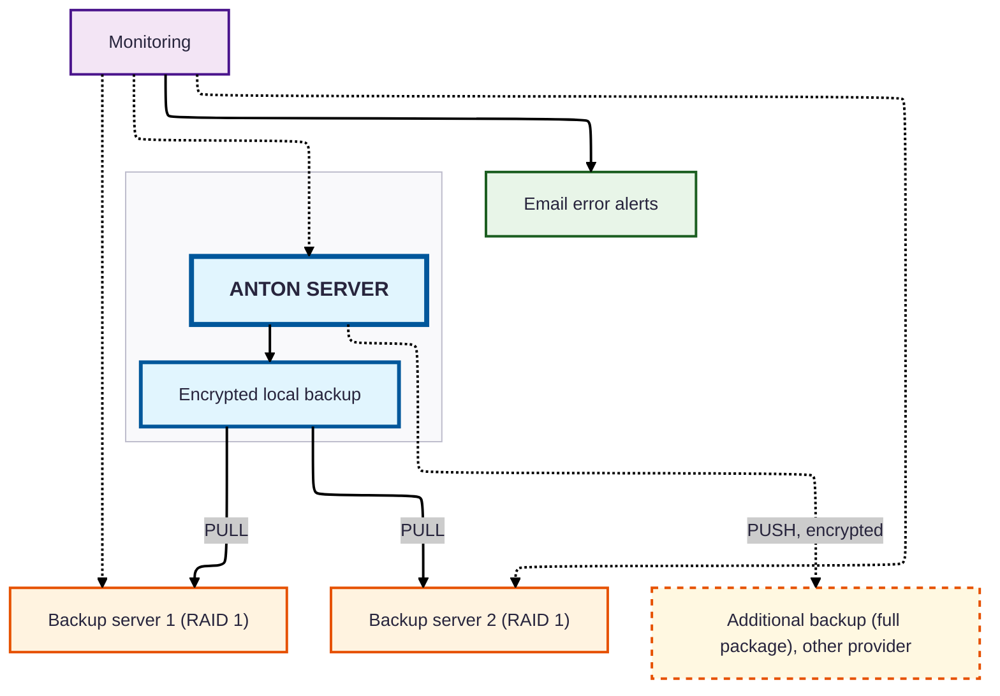

# Anton server infrastructure diagram

## Security features

- **Local data storage**: all data is stored in Switzerland; the full Digital Archive package adds a backup in Germany (in Switzerland on request)
- **Multi-level backups**: 
    - Hourly metadata backups (business hours)
    - Daily full backups (metadata + digitised objects)
- **Geographical distribution**: two backup servers at two locations in Zurich; with the production data and the local backup on the ANTON SERVER, four copies at three locations. The two Zurich locations share the regional risks; the additional backup of the full package adds a location independent of them
- **Mirroring**: both backup servers run as RAID 1; this protects against the failure of a disk but is not a further copy
- **Encryption**: all backups are stored and transmitted encrypted
- **Pull-based backups**: the backup servers fetch the data (no push)
    - protection against compromise of the production server
- **Additional backup** (with the [full Digital Archive package](longterm_archives.md#basic-offer-and-full-package)): every night a further backup with different software (restic) to object storage at a different provider. The production server encrypts it before it leaves the server and writes it itself; in return, no backup state can be deleted or overwritten for 30 days. In trial operation since November 2026
- **Continuous monitoring**: separate monitoring server
- **Proactive notification**: email alerts in case of problems
