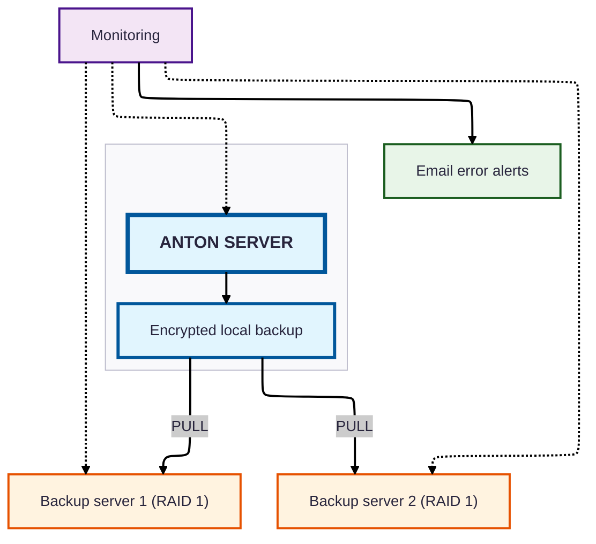

# Anton server infrastructure diagram

## Security features

- **Local data storage**: all data is stored in Switzerland
- **Multi-level backups**: 
    - Hourly metadata backups (business hours)
    - Daily full backups (metadata + digitised objects)
- **Geographical distribution**: two backup servers at two locations in Zurich; with the production data and the local backup on the ANTON SERVER, four copies at three locations. The two Zurich locations share the regional risks; there is no further, independent location for now
- **Mirroring**: both backup servers run as RAID 1; this protects against the failure of a disk but is not a further copy
- **Encryption**: all backups are stored and transmitted encrypted
- **Pull-based backups**: the backup servers fetch the data (no push)
    - protection against compromise of the production server
- **Continuous monitoring**: separate monitoring server
- **Proactive notification**: email alerts in case of problems
