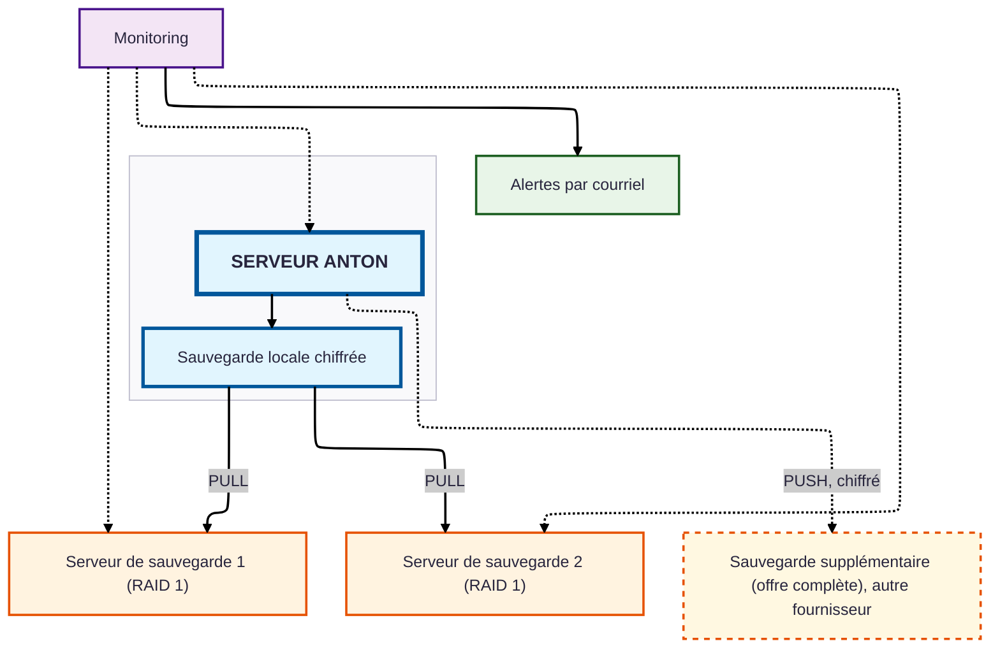

# Schéma de l'infrastructure serveur d'Anton

## Caractéristiques de sécurité

- **Stockage local des données** : toutes les données sont conservées en Suisse ; l'offre complète Archive numérique ajoute une sauvegarde en Allemagne (en Suisse sur demande)
- **Sauvegardes à plusieurs niveaux** : 
    - sauvegardes horaires des métadonnées (heures de bureau)
    - sauvegardes complètes quotidiennes (métadonnées + numérisations)
- **Répartition géographique** : deux serveurs de sauvegarde sur deux sites à Zurich ; avec les données de production et la sauvegarde locale sur le SERVEUR ANTON, quatre copies sur trois sites. Les deux sites zurichois partagent les mêmes risques régionaux ; la sauvegarde supplémentaire de l'offre complète ajoute un lieu indépendant de ceux-ci
- **Mise en miroir** : les deux serveurs de sauvegarde fonctionnent en RAID 1 ; cela protège contre la panne d'un disque, mais ne constitue pas une copie supplémentaire
- **Chiffrement** : toutes les sauvegardes sont stockées et transmises chiffrées
- **Sauvegardes en mode pull** : les serveurs de sauvegarde vont chercher les données (pas de push)
    - protection contre une compromission du serveur de production
- **Sauvegarde supplémentaire** (avec l'[offre complète Archive numérique](longterm_archives.md#offre-de-base-et-offre-complete)) : chaque nuit, une sauvegarde supplémentaire avec un autre logiciel (restic) vers un stockage objet chez un autre fournisseur. Le serveur de production la chiffre avant qu'elle ne le quitte et l'écrit lui-même ; en contrepartie, aucun état de sauvegarde ne peut être effacé ni écrasé pendant 30 jours. En exploitation de test depuis novembre 2026
- **Surveillance continue** : serveur de surveillance distinct
- **Notification proactive** : alertes par courriel en cas de problème
