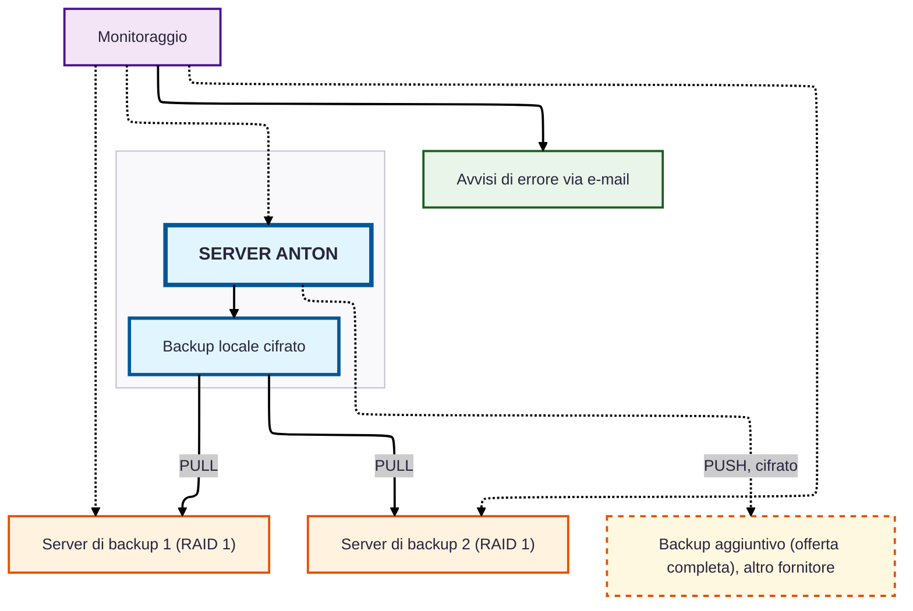

# Schema dell'infrastruttura server di Anton

## Caratteristiche di sicurezza

- **Memorizzazione locale dei dati**: tutti i dati sono conservati in Svizzera; l'offerta completa Archivio digitale aggiunge un backup in Germania (in Svizzera su richiesta)
- **Backup a più livelli**: 
    - backup orari dei metadati (orari lavorativi)
    - backup completi giornalieri (metadati + digitalizzazioni)
- **Distribuzione geografica**: due server di backup in due ubicazioni a Zurigo; con i dati di produzione e il backup locale sul SERVER ANTON, quattro copie in tre ubicazioni. Le due ubicazioni zurighesi condividono i rischi regionali; il backup aggiuntivo dell'offerta completa aggiunge un luogo indipendente da esse
- **Mirroring**: entrambi i server di backup funzionano in RAID 1; ciò protegge dal guasto di un disco, ma non costituisce un'ulteriore copia
- **Cifratura**: tutti i backup vengono conservati e trasmessi in forma cifrata
- **Backup basati su pull**: sono i server di backup a prelevare i dati (nessun push)
    - protezione da una compromissione del server di produzione
- **Backup aggiuntivo** (con l'[offerta completa Archivio digitale](longterm_archives.md#offerta-di-base-e-offerta-completa)): ogni notte un ulteriore backup con un altro software (restic) verso uno storage a oggetti presso un altro fornitore. Il server di produzione lo cifra prima che lasci il server e lo scrive esso stesso; in compenso nessuno stato di backup può essere cancellato o sovrascritto per 30 giorni. In esercizio di prova da novembre 2026
- **Sorveglianza continua**: server di sorveglianza separato
- **Notifica proattiva**: avvisi via e-mail in caso di problemi
