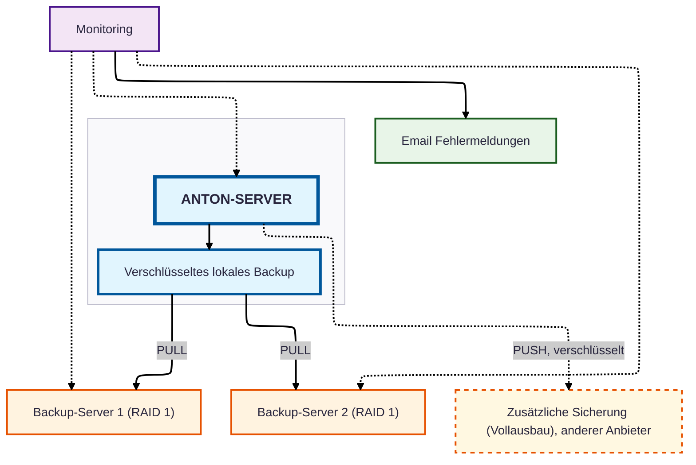

# Anton Server Infrastruktur Diagramm

## Sicherheitsmerkmale

- **Lokale Datenspeicherung**: Alle Daten werden in der Schweiz gespeichert; mit dem Vollausbau Digitales Archiv kommt eine Sicherung in Deutschland dazu (auf Anfrage in der Schweiz)
- **Mehrstufige Backups**: 
    - Stündliche Metadaten-Backups (Geschäftszeiten)
    - Tägliche Vollbackups (Metadaten + Digitalisate)
- **Geografische Verteilung**: Zwei Backup-Server an zwei Standorten in Zürich; mit den Produktionsdaten und dem lokalen Backup auf dem ANTON-SERVER vier Kopien an drei Standorten. Die beiden Zürcher Standorte teilen sich die regionalen Risiken; einen davon unabhängigen Ort bringt die Zusätzliche Sicherung des Vollausbaus
- **Spiegelung**: Beide Backup-Server laufen als RAID 1; das schützt vor dem Ausfall einer Platte, ist aber keine weitere Kopie
- **Verschlüsselung**: Alle Backups verschlüsselt gespeichert und übertragen
- **Pull-basierte Backups**: Backup-Server holen Daten ab (kein Push)
    - Schutz vor Kompromittierung des Produktionsservers
- **Zusätzliche Sicherung** (mit dem [Vollausbau Digitales Archiv](longterm_archives.md#grundangebot-und-vollausbau)): jede Nacht eine weitere Sicherung mit anderer Software (restic) in einen Objektspeicher bei einem anderen Anbieter. Der Produktivserver verschlüsselt sie, bevor sie ihn verlässt, und schreibt sie selbst; dafür lässt sich jeder Stand 30 Tage lang nicht löschen oder überschreiben. Seit November 2026 im Testbetrieb
- **Kontinuierliche Überwachung**: Separater Überwachungsserver 
- **Proaktive Benachrichtigung**: Email-Alerts bei Problemen
