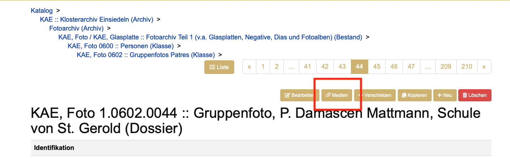
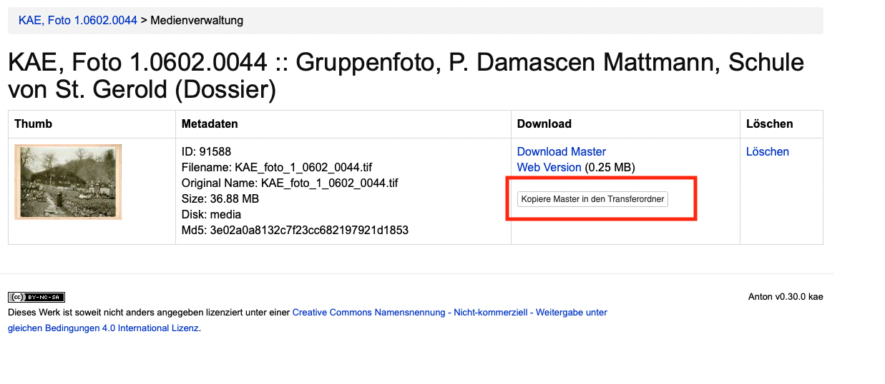
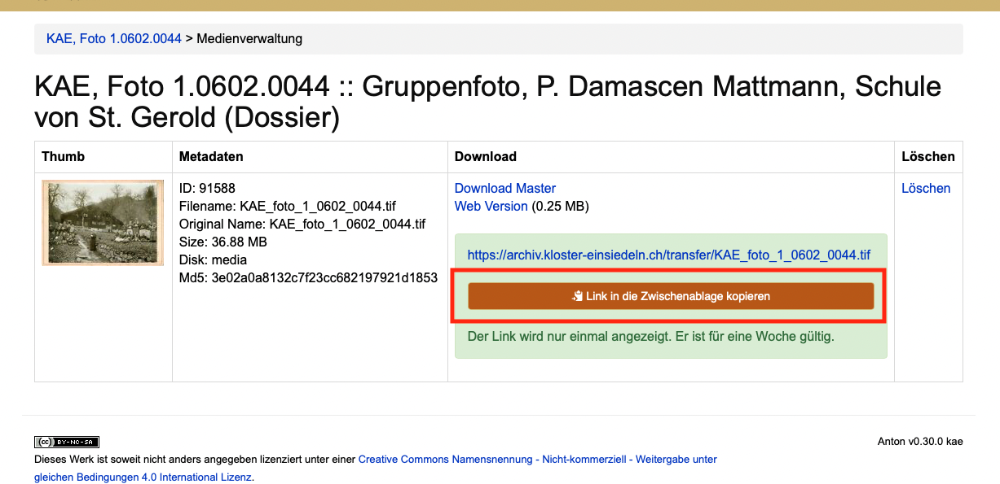

# Media

All'importazione di media Anton crea normalmente una copia di consultazione. Questa è ottimizzata per l'uso sul web. Se non sono bloccati per altri motivi, gli utenti esterni hanno accesso solo a questa versione web.

## Formati dei media

In linea di principio è consigliabile utilizzare come formati di partenza il minor numero possibile di formati diversi. Ciò rende la gestione e la manutenzione a lungo termine più chiare e più semplici. Esistono inoltre formati di file più adatti all'archiviazione di altri. Su questo tema forniscono informazioni numerosi archivi pubblici e servizi specializzati nella conservazione digitale a lungo termine.

Per i seguenti formati Anton produce copie di consultazione; un'estensione è facilmente implementabile in qualsiasi momento all'occorrenza. L'importazione di altri formati è possibile, ma dovrebbe se possibile essere testata. Alcuni formati non vengono convertiti (ad es. DOCX, XLSX, TXT, ZIP).

### Foto  
- TIFF  
- JPEG2000  
- PNG  
- JPEG

### Documenti  
- PDF/A
- PDF

### Video
- MP4  
- Quicktime

### Audio
- WAV  
- MPEG  
- MP3  

## Metadati tecnici (AV)

Anton misura audio e video con `ffprobe` all'acquisizione e mostra i valori
sul media sotto «Caratteristiche tecniche»: contenitore, durata, bitrate,
immagine (codec, dimensioni, rapporto d'aspetto, frequenza dei fotogrammi) e
audio (codec, canali, frequenza di campionamento, profondità di bit). Per i
media più vecchi il controllo notturno dei formati aggiunge le caratteristiche.

I valori vengono forniti anche nell'esportazione RDF (profili Memobase, RiC e
A+) come proprietà EBUcore, vedi [Esportazione RDF](../admin/download-rdf.md).
Per le fotografie viene fornita solo la dimensione dell'immagine.

## Modificare l'ordine dei media

L'ordine dei media di un'unità di descrizione può essere modificato senza
doverli eliminare e caricare di nuovo.

Nella **scheda dei media** dell'unità di descrizione ogni media dispone di una
coppia di frecce (↑ ↓). Un clic sposta il media di una posizione all'interno
della propria raccolta. Per il primo e per l'ultimo media la rispettiva freccia
è disattivata.

L'ordine vale per la visualizzazione nel catalogo, nella galleria e nel
visualizzatore — è lo stesso ordine attribuito al momento del caricamento.

Immagini e documenti vengono ordinati separatamente: un'immagine non può
scambiare il proprio posto con un documento.

Il riordino è una modifica visibile e viene registrato di conseguenza sulla
scheda (data di modifica, persona che ha modificato, protocollo delle modifiche).
Richiede la stessa autorizzazione necessaria per eliminare un media.

## Mettere a disposizione i media originali
Per mettere a disposizione della clientela i media originali si apre la scheda dei media in un'unità di descrizione:

 
Lì fare clic sul pulsante «Copia il master nella cartella di trasferimento».

Copiare il link facendo clic su «Copia il link negli appunti».

Inviare il link alla persona interessata per e-mail. Il link è valido una settimana, dopodiché il file copiato viene eliminato automaticamente.
